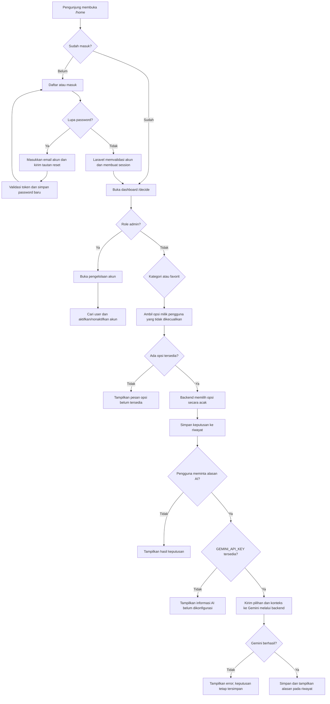
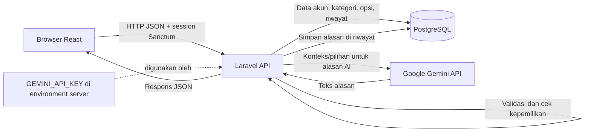

# Dokumentasi Proyek Decide For Me

> Dokumen ini merangkum kebutuhan, ruang lingkup, fitur, role, alur kerja, rencana presentasi pra-UKS, dan bahan tanya jawab proyek **Decide For Me**.

## 1. Informasi Proyek

| Item | Keterangan |
|---|---|
| Nama aplikasi | Decide For Me |
| Jenis aplikasi | Aplikasi web dinamis untuk membantu pengguna memilih opsi secara acak |
| Frontend | React, TypeScript, dan Vite |
| Backend | Laravel sebagai JSON API |
| Database | PostgreSQL |
| Autentikasi | Session-based SPA authentication dengan Laravel Sanctum |
| AI | Google Gemini API, dipanggil dari backend secara opsional |
| Role | Pengunjung, pengguna terdaftar, dan admin |
| Dokumentasi instalasi | [README.md](./README.md) |
| Repository GitHub | Tambahkan URL repository proyek setelah tersedia |

## 2. Analisis Kebutuhan

### 2.1 Latar Belakang Masalah

Dalam kehidupan sehari-hari, seseorang sering menghadapi banyak pilihan sederhana—misalnya memilih makanan, kegiatan, atau rencana belajar. Terlalu banyak pilihan dapat membuat proses mengambil keputusan terasa lama dan melelahkan.

Decide For Me menyediakan tempat untuk menyimpan pilihan, memilih salah satu opsi secara acak, dan mencatat hasilnya. AI dapat memberikan perspektif singkat tentang hasil pilihan berdasarkan konteks yang ditulis pengguna. AI tidak menentukan hasil undian dan tidak menggantikan pertimbangan pengguna.

### 2.2 Tujuan dan Manfaat

- Membantu pengguna mengambil keputusan sederhana dengan lebih cepat.
- Menyimpan kategori dan opsi agar dapat digunakan kembali.
- Menyediakan riwayat pilihan untuk ditinjau kembali.
- Memungkinkan pengguna menandai opsi favorit dan mengecualikan opsi tertentu.
- Memberikan alasan atau perspektif AI secara opsional, tanpa menjadikan AI sebagai penentu pilihan.
- Menyediakan data yang tetap tersimpan setelah pengguna kembali membuka aplikasi.

### 2.3 Kebutuhan Pengguna

**Kebutuhan fungsional**

1. Pengguna dapat mendaftar, masuk, dan keluar dari akun.
2. Pengguna dapat meminta tautan reset password ke email akunnya.
3. Pengguna dapat membuat, melihat, mengubah, dan menghapus kategori.
4. Pengguna dapat mengelola opsi di dalam kategori.
5. Pengguna dapat memilih kategori atau menggunakan opsi favorit untuk pengundian.
6. Sistem memilih opsi secara acak dari opsi yang tersedia dan tidak dikecualikan.
7. Sistem menyimpan keputusan ke riwayat dan pengguna dapat mengubah statusnya.
8. Pengguna dapat meminta alasan AI untuk keputusan yang sudah dibuat.
9. Pengguna dapat mencari, memfilter, dan mengurutkan data yang tersedia di aplikasi.
10. Admin dapat melihat daftar akun serta mengaktifkan atau menonaktifkan akun pengguna.

**Kebutuhan nonfungsional**

- Tampilan responsif dan dapat digunakan melalui desktop maupun ponsel.
- Kontrol antarmuka dapat digunakan dengan keyboard dan memiliki umpan balik.
- Data setiap pengguna harus terisolasi dan hanya dapat diakses pemiliknya.
- API memvalidasi masukan dan memerlukan autentikasi untuk data privat.
- API key AI disimpan di environment backend, tidak dikirim ke browser.
- Aplikasi tetap dapat melakukan undian ketika layanan AI tidak dikonfigurasi atau tidak tersedia.

## 3. Ruang Lingkup

### 3.1 Termasuk dalam aplikasi saat ini

- Landing page di `/home`.
- Registrasi, login, dan logout.
- Dashboard keputusan di `/decide`.
- CRUD kategori dan opsi.
- Pengaturan favorit dan pengecualian opsi.
- Pengundian acak dan riwayat dengan status keputusan.
- Penjelasan AI opsional melalui Gemini.
- Pencarian, filter, dan pengurutan yang didukung oleh antarmuka dan API.
- Penyimpanan data akun di PostgreSQL.

### 3.2 Di luar implementasi saat ini

- AI tidak membuat atau menyimpan opsi secara otomatis.
- AI tidak memilih hasil undian; hasil dipilih secara acak oleh aplikasi sebelum alasan diminta.

Admin tidak mengakses data keputusan pribadi pengguna dan tidak dapat menonaktifkan akun admin dari panel user management. Repository GitHub perlu ditautkan setelah URL repository proyek tersedia.

## 4. Role dan Hak Akses

| Role | Status | Hak akses |
|---|---|---|
| Pengunjung | Tersedia | Melihat landing page dan membuka halaman masuk/daftar/lupa password. Data dashboard memerlukan autentikasi. |
| Pengguna terdaftar | Tersedia | Mengelola kategori, opsi, favorit, pengecualian, undian, alasan AI, dan riwayat milik akunnya sendiri; meminta reset password melalui email. |
| Admin | Tersedia | Khusus mengelola akun: melihat daftar akun (nama, email, role, status, tanggal bergabung), mencari dan memaginasi akun, serta mengaktifkan/menonaktifkan user. Admin tidak dapat menggunakan fitur keputusan atau mengakses kategori, opsi, konteks AI, dan riwayat keputusan. Akun admin dilindungi agar tidak dapat dinonaktifkan dari daftar. |

Backend memeriksa autentikasi dan role pada setiap endpoint admin. Pengguna yang dinonaktifkan tidak dapat masuk atau mengakses endpoint yang memerlukan akun aktif. Registrasi publik selalu menghasilkan role user; role tidak bisa dipilih dari form.

### Menyiapkan akun admin

1. Daftarkan akun yang akan dijadikan admin melalui `/register`.
2. Dari folder `backend`, jalankan:

   ```sh
   php artisan app:promote-admin admin@example.com
   ```

3. Konfirmasi promosi akun di terminal, lalu login dan buka `/admin` atau menu **User management**.

Perintah hanya mempromosikan akun yang sudah terdaftar; tidak ada password admin bawaan atau kredensial privileged di source code.

## 5. Fitur Utama dan Alur Pengguna

### 5.1 Akun

- Pengguna baru dapat membuat akun melalui `/register`.
- Pengguna yang sudah memiliki akun dapat masuk melalui `/login`.
- Setelah autentikasi, session dikelola oleh Laravel Sanctum.
- Pengguna dapat keluar melalui aksi sign out.
- Tautan **Forgot your password?** mengirim reset link ke email yang dimasukkan jika akun tersebut terdaftar. Respons tetap generik agar keberadaan email tidak bocor.
- Token reset berlaku 60 menit dan hanya dapat digunakan sekali. Reset membutuhkan mail provider yang dikonfigurasi; `MAIL_MAILER=log` hanya menulis email ke log lokal.

### 5.2 Kategori dan Opsi

- Pengguna membuat kategori, misalnya “Makanan” atau “Rencana Belajar”.
- Pengguna menambahkan beberapa opsi ke kategori.
- Pengguna dapat mengubah atau menghapus kategori dan opsi.
- Aplikasi menampilkan jumlah opsi pada kategori.
- Opsi dapat ditandai sebagai favorit atau dikecualikan dari pengundian.
- Masukan divalidasi agar data kosong atau duplikat yang tidak diperbolehkan dapat ditolak.

### 5.3 Pengundian dan Riwayat

- Pengguna memilih kategori atau memilih mode opsi favorit.
- Backend mengambil opsi milik pengguna yang tidak dikecualikan, lalu memilihnya secara acak.
- Hasil disimpan sebagai riwayat dengan kategori, nama opsi, waktu, dan status.
- Pengguna dapat menandai hasil sebagai selesai atau dilewati, mengundi ulang, atau menghapus riwayat.
- Jika tidak ada opsi yang dapat dipilih, aplikasi menampilkan informasi bahwa opsi belum tersedia.

### 5.4 AI Decision Reason

- Pengundian dilakukan aplikasi terlebih dahulu; AI hanya menjelaskan hasil yang sudah terpilih.
- Pengguna dapat menambahkan konteks singkat yang relevan sebelum meminta alasan.
- Konteks dikirim ke server, lalu server membuat permintaan ke Gemini. Konteks tidak disimpan oleh aplikasi.
- Hasil alasan AI disimpan bersama entri riwayat keputusan pengguna.
- API key hanya berada di environment backend, contohnya `GEMINI_API_KEY`.
- Jika key belum diatur, model gagal, atau layanan tidak dapat dijangkau, aplikasi menampilkan error yang sesuai dan keputusan acak tetap dapat digunakan.
- Model default saat dokumen ini dibuat adalah `gemini-3.5-flash-lite`; nilai dapat diatur melalui `GEMINI_MODEL`.

### 5.5 Lupa password

- Form tersedia dari `/login` dan dapat diminta melalui `/forgot-password`.
- Email reset dikirim ke alamat akun yang dimasukkan; tautan membuka `/reset-password` dengan token.
- Laravel Password Broker memvalidasi token dan kedaluwarsanya sebelum menyimpan hash password baru.
- Mailer contoh default adalah `log`; pengiriman ke inbox membutuhkan konfigurasi SMTP/provider dan `APP_URL` yang benar di environment server.

## 6. Flowchart

### 6.1 Alur aplikasi dan keputusan



### 6.2 Alur data dan keamanan



## 7. Arsitektur Singkat

1. **Frontend:** React dan TypeScript menampilkan halaman serta mengirim permintaan API.
2. **Backend:** Laravel menangani autentikasi, validasi, aturan bisnis, pemeriksaan kepemilikan, dan integrasi Gemini.
3. **Database:** PostgreSQL menyimpan akun, kategori, opsi, dan riwayat.
4. **Autentikasi:** Sanctum memakai session untuk SPA; endpoint data privat berada di balik middleware autentikasi.
5. **Otorisasi admin:** role `user`/`admin` disimpan di database; endpoint pengelolaan akun dilindungi middleware admin. Admin hanya menerima data profil dasar dan status akun.
6. **Reset password:** Laravel Password Broker membuat dan memvalidasi token sekali pakai; email dikirim melalui mailer yang dikonfigurasi.
7. **AI:** Server mengirim permintaan ke Gemini menggunakan key dari environment. Key tidak disertakan dalam kode atau bundle frontend.

Endpoint API utama mencakup registrasi/login, dashboard, kategori, opsi, favorit, pengundian, riwayat, dan permintaan alasan AI. Rute API lengkap dapat dilihat di [backend/routes/api.php](./backend/routes/api.php).

## 8. Panduan Presentasi Pra-UKS

Sesuaikan nama presenter dan durasi dengan kebutuhan. Pastikan fitur yang didemokan telah disiapkan dan diuji.

### 1. Salam dan pengenalan diri

Contoh:

> “Selamat pagi/siang. Perkenalkan, saya [nama]. Pada kesempatan ini saya akan mempresentasikan proyek web Decide For Me, yaitu aplikasi untuk membantu pengguna mengambil keputusan sederhana.”

### 2. Demo website portofolio

- Tampilkan website portofolio yang diminta dalam presentasi.
- Jelaskan tujuan, bagian utama, dan teknologi yang digunakan.
- Pastikan tautan dan halaman yang akan dibuka sudah siap.

### 3. Pengenalan website dinamis

Jelaskan secara singkat:

- **Latar belakang:** pengguna terkadang kesulitan memilih di antara beberapa opsi sederhana.
- **Manfaat:** aplikasi menyimpan opsi dan memilih satu secara acak sehingga proses memilih lebih praktis.
- **Ruang lingkup:** akun pengguna, kategori, opsi, favorit, pengundian, riwayat, dan alasan AI opsional.
- **Role saat ini:** pengunjung, pengguna terdaftar, dan admin. Admin hanya mengelola akun dan tidak memiliki akses ke fitur keputusan atau data keputusan.

### 4. Demo website dinamis

Urutan demo yang disarankan:

1. Tampilkan beranda `/home`.
2. Daftar akun atau masuk menggunakan akun demo yang sudah disiapkan.
3. Di `/decide`, jelaskan dashboard dan cara memilih kategori.
4. Tunjukkan daftar kategori dan opsi; tambahkan atau ubah data demo bila diperlukan.
5. Tunjukkan favorit dan cara mengecualikan opsi.
6. Jalankan pengundian, lalu tunjukkan hasil dan riwayat/status keputusan.
7. Jika Gemini sudah dikonfigurasi, tunjukkan permintaan alasan AI dan jelaskan bahwa AI hanya memberi perspektif. Jika belum, jelaskan bahwa AI opsional dan jangan mengklaim hasil AI berhasil.
8. Jika presentasi mencakup admin, masuk menggunakan akun yang telah dipromosikan dengan `app:promote-admin`, kemudian tunjukkan daftar user, pencarian, serta aktivasi/nonaktivasi akun. Admin tidak menggunakan fitur pengambilan keputusan.
9. Tunjukkan lupa password. Jika SMTP belum diatur, jelaskan bahwa mode lokal mencatat email ke log dan jangan klaim email sudah diterima inbox.

### 5. Testing kinerja web

- Jalankan pengujian pada browser dan perangkat/ukuran layar berbeda.
- Gunakan Chrome DevTools Lighthouse atau alat yang disetujui penguji untuk mengukur performa.
- Catat perangkat, browser, kondisi jaringan, skor, dan temuan; jangan mengarang nilai pengujian.
- Periksa waktu muat, ukuran halaman, responsivitas, error di Console/Network, dan pengalaman saat API lambat/gagal.
- Tunjukkan bukti hasil pengujian yang benar-benar dijalankan.

## 9. Bahan Pertanyaan Penguji

### 9.1 Pengetahuan umum

**Apa tujuan aplikasi ini?**  
Membantu pengguna memilih salah satu dari beberapa opsi secara praktis, menyimpan keputusan, dan meninjau riwayatnya.

**Apa manfaat dibanding memilih manual?**  
Opsi dapat dikelola dan digunakan kembali. Pemilihan acak membantu mengurangi waktu yang dihabiskan untuk keputusan sederhana, tetapi hasilnya tetap dapat dipertimbangkan oleh pengguna.

### 9.2 Bahasa pemrograman web dan framework

**Teknologi apa yang digunakan?**  
Frontend menggunakan TypeScript, React, dan Vite. Backend menggunakan PHP dengan Laravel. Data disimpan di PostgreSQL.

**Apa fungsi React dan Laravel?**  
React menyusun antarmuka interaktif di browser. Laravel menyediakan API, autentikasi, validasi, aturan bisnis, dan akses ke database serta layanan AI.

**Apa fungsi TypeScript?**  
TypeScript menambahkan pemeriksaan tipe pada JavaScript sehingga kesalahan tipe tertentu dapat diketahui saat pengembangan.

### 9.3 UI/UX

**Bagaimana aplikasi membantu kenyamanan pengguna?**  
Alur dibuat terarah, kontrol utama terlihat jelas, data dikelompokkan dalam kategori, dan antarmuka menampilkan feedback/keadaan kosong ketika diperlukan. Layout mendukung ukuran desktop dan mobile.

**Mengapa ada status, favorit, dan pengecualian?**  
Favorit memudahkan pengundian dari opsi pilihan pengguna, pengecualian mencegah opsi tertentu terambil, dan status/riwayat membantu melacak hasil.

### 9.4 Cara kerja web

**Apa yang terjadi ketika tombol pengundian ditekan?**  
Frontend mengirim permintaan terautentikasi ke Laravel. Backend mengambil opsi yang sesuai dengan akun dan filter, mengabaikan opsi yang dikecualikan, memilih satu opsi secara acak, menyimpan keputusan, lalu mengirim hasilnya kembali.

**Bagaimana data antar pengguna dipisahkan?**  
Backend mengharuskan autentikasi dan memeriksa kepemilikan data sebelum mengakses atau mengubah kategori, opsi, dan riwayat.

**Admin bisa memakai fitur keputusan juga?**  
Tidak. Admin dibatasi untuk pengelolaan akun. Endpoint fitur keputusan dan data kategori/opsi ditolak untuk role admin; pengguna biasa tetap memakai fitur keputusan seperti sebelumnya.

**Apa tujuan fitur admin?**  
Admin dapat melihat nama, email, role, status, dan tanggal pendaftaran akun; mencari akun; serta mengaktifkan atau menonaktifkan akun user. Pengelolaan akun dipisahkan dari data keputusan pribadi untuk menjaga privasi.

**Bagaimana akun admin dibuat?**  
Daftarkan akun terlebih dahulu, lalu jalankan `php artisan app:promote-admin alamat@email` dari folder `backend` dan konfirmasi promosi di terminal.

**Bagaimana fitur lupa password bekerja?**  
Pengguna memasukkan email akun di `/forgot-password`. Laravel mengirim token reset sekali pakai ke email tersebut melalui mailer yang dikonfigurasi. Tautan berlaku 60 menit dan form `/reset-password` mengirim token, email, serta password baru ke backend untuk divalidasi.

**Apakah email pasti terkirim pada konfigurasi lokal?**  
Tidak jika `MAIL_MAILER=log`; konfigurasi itu hanya menulis email ke log. Pengiriman ke inbox perlu kredensial SMTP/provider yang valid dan `APP_URL` yang sesuai di environment backend.

**Bagaimana AI bekerja?**  
AI dipanggil setelah opsi dipilih. Server mengirim nama kategori, opsi terpilih, dan konteks opsional ke Gemini. AI menghasilkan alasan singkat; ia tidak menentukan hasil acak.

### 9.5 Testing

**Apa yang diuji?**  
Validasi request, autentikasi, izin dan kepemilikan data, CRUD, pengundian dan pengecualian, favorit, riwayat, serta integrasi AI menggunakan respons provider yang disimulasikan dalam pengujian.

**Bagaimana memeriksa kualitas aplikasi?**  
Jalankan lint/type-check, build frontend, pengujian Laravel, lalu uji alur secara manual pada browser dan viewport berbeda. Untuk kinerja, gunakan alat ukur dan laporkan hasil nyata.

**Apa yang dilakukan jika Gemini gagal?**  
Error ditampilkan kepada pengguna. Keputusan yang sudah diundi tetap tersedia; fitur inti tidak bergantung pada AI.

### 9.6 Dokumentasi

**Apa perbedaan README dan DOKUM?**  
`README.md` berfokus pada gambaran teknis, prasyarat, instalasi, konfigurasi, dan perintah menjalankan aplikasi. `DOKUM.md` merangkum PRD, role, alur, panduan presentasi, dan bahan pertanyaan.

### 9.7 AI

**Apakah AI memilih keputusan?**  
Tidak. Backend memilih opsi secara acak. AI hanya memberi perspektif singkat atas hasil yang sudah dipilih.

**Bagaimana API key dilindungi?**  
Key disimpan sebagai environment variable backend dan tidak dimasukkan ke frontend. Jangan pernah menampilkan key dalam presentasi, screenshot, log publik, atau repository.

**Apakah konteks pengguna disimpan?**  
Konteks opsional dikirim ke Google Gemini untuk membuat alasan dan tidak disimpan oleh aplikasi. Teks alasan yang dihasilkan disimpan di riwayat keputusan.

## 10. Checklist Sebelum Presentasi

- [ ] Pastikan server frontend, backend, dan database berjalan.
- [ ] Siapkan akun demo dan data contoh yang tidak berisi informasi pribadi.
- [ ] Jika mendemokan admin, jalankan `php artisan app:promote-admin email-demo` untuk akun demo dan uji `/admin`.
- [ ] Jika mendemokan lupa password, konfigurasi SMTP/provider dan pastikan tautan reset diterima di inbox; `MAIL_MAILER=log` tidak mengirim email sungguhan.
- [ ] Pastikan akun dapat masuk dan membuka dashboard.
- [ ] Periksa alur kategori, opsi, favorit, pengecualian, pengundian, dan riwayat.
- [ ] Jika mendemokan AI, pastikan `GEMINI_API_KEY` tersedia di environment backend dan permintaan AI berhasil. Jangan tampilkan nilainya.
- [ ] Siapkan fallback penjelasan jika koneksi internet atau layanan AI bermasalah.
- [ ] Uji tampilan desktop dan mobile.
- [ ] Jalankan `npm run lint`, `npm run build`, dan `cd backend && php artisan test`.
- [ ] Siapkan repository GitHub dan tautannya bila diminta; jangan memasukkan file `.env` atau secret ke repository.
- [ ] Catat hasil pengujian performa yang benar-benar diperoleh.
