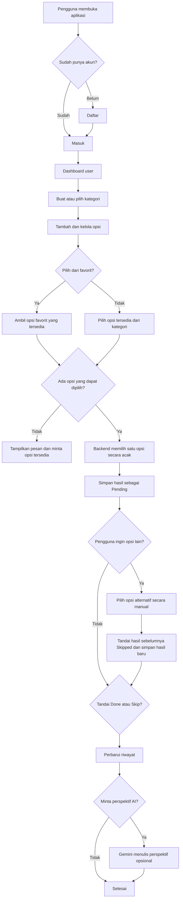
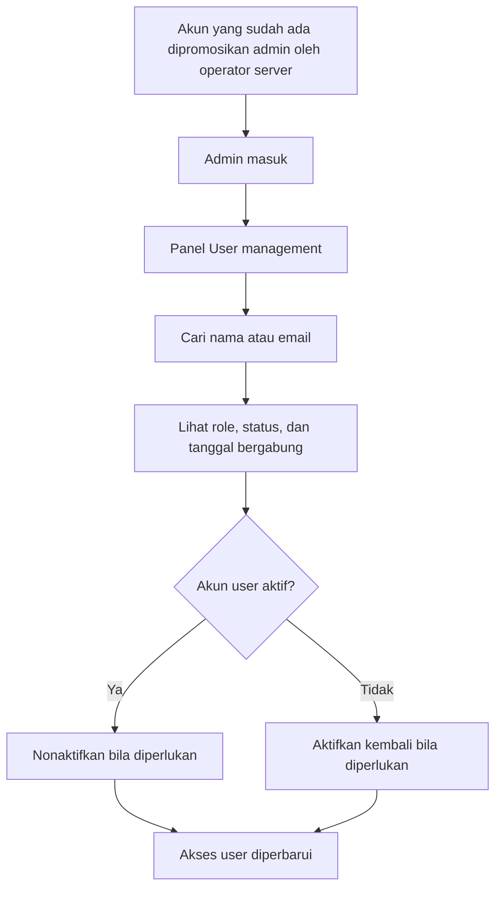
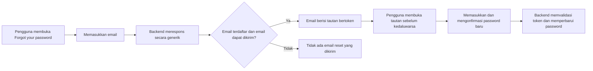

# Decide For Me — PRD & Alur Sistem

> Dokumen ini menjelaskan tujuan, kebutuhan, ruang lingkup, fitur, role, alur kerja, dan rancangan teknis aplikasi Decide For Me.

## Daftar Isi

- [Ringkasan Proyek](#ringkasan-proyek)
- [Latar Belakang dan Tujuan](#latar-belakang-dan-tujuan)
- [Analisis Kebutuhan](#analisis-kebutuhan)
- [Ruang Lingkup](#ruang-lingkup)
- [Role dan Hak Akses](#role-dan-hak-akses)
- [Fitur Utama](#fitur-utama)
- [Alur Kerja](#alur-kerja)
- [Teknologi dan Arsitektur](#teknologi-dan-arsitektur)
- [Keamanan dan Privasi](#keamanan-dan-privasi)
- [Menjalankan Proyek](#menjalankan-proyek)
- [Pengujian](#pengujian)
- [Panduan Penggunaan](#panduan-penggunaan)

## Ringkasan Proyek

| Informasi | Keterangan |
|---|---|
| Nama | Decide For Me |
| Jenis | Aplikasi web dinamis untuk membantu memilih di antara beberapa opsi |
| Pengguna utama | Pengguna yang ingin mengatur pilihan pribadi dan membuat keputusan sederhana |
| Frontend | React, TypeScript, Vite |
| Backend | Laravel JSON API |
| Database | PostgreSQL |
| Autentikasi | Session-based SPA authentication dengan Laravel Sanctum |
| AI opsional | Google Gemini untuk memberi perspektif setelah pilihan dibuat |

Decide For Me membantu pengguna menyimpan opsi dalam kategori, memilih opsi secara acak, dan meninjau keputusan sebelumnya. AI bersifat opsional: aplikasi memilih hasilnya, sedangkan AI hanya dapat menulis perspektif singkat tentang hasil tersebut.

## Latar Belakang dan Tujuan

Memilih makanan, kegiatan, atau rencana sederhana kadang menyita waktu karena terlalu banyak mempertimbangkan pilihan. Aplikasi ini menyediakan tempat untuk mengelola pilihan dan membantu pengguna segera menentukan langkah berikutnya.

Tujuan produk:

1. Memudahkan pengguna menyimpan dan menemukan kembali pilihan.
2. Memilih opsi yang tersedia secara acak ketika pengguna meminta bantuan.
3. Menyimpan riwayat agar hasil keputusan dapat ditinjau dan diberi status.
4. Memberi perspektif AI secara opsional tanpa menyerahkan keputusan kepada AI.
5. Menyediakan administrasi akun yang terpisah dari data keputusan pribadi.

## Analisis Kebutuhan

### Kebutuhan fungsional

- Pengunjung dapat membuka halaman utama, masuk, mendaftar, atau meminta reset password.
- Pengguna terdaftar dapat mengelola kategori dan opsi miliknya sendiri.
- Pengguna dapat mencari, memfilter, dan mengurutkan kategori atau opsi pada tampilan yang sesuai.
- Pengguna dapat menandai opsi sebagai favorit atau mengecualikannya dari pengundian.
- Pengguna dapat mengundi opsi dari suatu kategori atau dari daftar favorit yang tersedia.
- Setelah pengundian, pengguna dapat menandai hasil sebagai **Done** atau **Skip**, atau memilih opsi lain sendiri.
- Riwayat dapat ditinjau, dimuat per halaman, dan dihapus.
- Pengguna dapat meminta alasan AI untuk hasil yang sudah dipilih.
- Admin dapat mencari dan melihat daftar akun serta mengaktifkan atau menonaktifkan akun user.

### Kebutuhan nonfungsional

- Antarmuka responsif untuk desktop dan ponsel.
- API memvalidasi masukan dan memeriksa autentikasi, role, status akun, serta kepemilikan data.
- Data keputusan suatu akun tidak dapat diakses akun lain atau admin.
- Kegagalan layanan AI tidak menghalangi fitur keputusan acak.
- API key dan kredensial email hanya disimpan di environment backend.
- Error penting ditampilkan kepada pengguna tanpa membocorkan informasi sensitif akun.

## Ruang Lingkup

### Termasuk

- Landing page dan demo interaktif.
- Registrasi, login, logout, dan reset password melalui email.
- Dashboard pengguna.
- CRUD kategori dan opsi, favorit, pengecualian, pencarian, filter, dan pengurutan.
- Pengundian acak, pemilihan alternatif manual, serta riwayat dan status keputusan.
- Perspektif AI opsional dari Gemini.
- Panel admin untuk pencarian akun dan aktivasi/nonaktivasi user.

### Tidak termasuk

- AI tidak membuat opsi dan tidak menentukan hasil undian.
- Admin tidak memakai fitur keputusan serta tidak dapat membaca atau mengelola kategori, opsi, konteks AI, dan riwayat pengguna.
- Pengaturan kredensial SMTP atau API key AI melalui panel admin.
- Penghapusan akun pengguna dari panel admin.

## Role dan Hak Akses

| Role | Hak akses |
|---|---|
| Pengunjung | Melihat halaman utama serta membuka halaman masuk, pendaftaran, dan pemulihan password. |
| User | Mengelola kategori, opsi, favorit, keputusan, alasan AI, dan riwayat untuk akunnya sendiri. |
| Admin | Khusus pengelolaan akun: melihat nama, email, role, status, tanggal bergabung; mencari akun; mengaktifkan atau menonaktifkan akun user. Tidak memiliki akses ke fitur keputusan. |

Semua pendaftaran baru menjadi role `user`. Promosi menjadi admin dilakukan operator server untuk akun yang sudah terdaftar. Panel tidak mengizinkan admin menonaktifkan akun admin.

## Fitur Utama

### Kategori dan opsi

Pengguna membuat kategori, misalnya “Makanan”, lalu menyimpan opsi seperti “Soto” atau “Nasi goreng”. Kategori dan opsi dapat diperbarui atau dihapus. Opsi dapat difavoritkan maupun dikecualikan dari pilihan.

### Pengambilan keputusan

Pengguna memilih kategori atau mode favorit. Backend mengambil opsi milik pengguna yang tersedia dan tidak dikecualikan, lalu memilih satu secara acak. Hasil langsung disimpan ke riwayat dengan status awal **Pending**.

Jika pengguna tidak cocok dengan hasil:

- **Choose another** menampilkan pilihan lain untuk dipilih secara manual.
- Hasil pending sebelumnya berubah menjadi **Skipped**.
- Pilihan baru dicatat sebagai entri riwayat pending yang baru.

### Riwayat

Riwayat menyimpan kategori, nama opsi yang terpilih, waktu, status, dan alasan AI jika tersedia. Status yang tersedia adalah **Pending**, **Done**, dan **Skipped**. Pengguna dapat memuat riwayat lama, menghapus satu entri, atau membersihkan seluruh riwayat.

### Perspektif AI

Setelah hasil dipilih, backend dapat meminta Gemini menghasilkan perspektif singkat. Konteks opsional dikirim ke Google Gemini dan tidak disimpan oleh aplikasi; teks alasan yang dihasilkan disimpan bersama riwayat. Jika Gemini tidak tersedia, hasil keputusan tetap dapat dipakai.

### Pengelolaan akun admin

Admin dapat mencari berdasarkan nama atau email, berpindah halaman, serta mengaktifkan atau menonaktifkan akun user. Akun nonaktif tidak dapat login atau memakai endpoint yang memerlukan akun aktif. Admin tidak dapat menonaktifkan akun admin melalui panel.

## Alur Kerja

### Alur user membuat keputusan



### Alur admin



### Alur reset password



## Teknologi dan Arsitektur

```text
Browser (React + TypeScript)
       │ same-origin JSON API + session
       ▼
Laravel API ───── PostgreSQL
       ├───────── Google Gemini (opsional)
       └───────── Mail provider / SMTP (reset password)
```

- **React, TypeScript, Vite:** antarmuka, interaksi, dan build frontend.
- **Laravel:** autentikasi, validasi request, pemeriksaan role dan kepemilikan, aturan bisnis, integrasi email, dan Gemini.
- **Laravel Sanctum:** autentikasi session untuk SPA same-origin.
- **PostgreSQL:** penyimpanan akun, kategori, opsi, dan riwayat.
- **Google Gemini:** menghasilkan perspektif opsional setelah undian.
- **Mail provider:** mengirim tautan reset password; `MAIL_MAILER=log` hanya menulis pesan ke log lokal.

## Keamanan dan Privasi

- Pendaftaran publik tidak dapat menetapkan role admin.
- Endpoint admin memerlukan autentikasi aktif dan role admin.
- Endpoint kategori, opsi, dashboard, dan keputusan hanya tersedia bagi user biasa; admin ditolak oleh backend.
- Data kategori, opsi, dan riwayat dibatasi pada pemiliknya.
- Admin hanya menerima informasi akun yang diperlukan untuk administrasi.
- Jangan menaruh `.env`, SMTP password, Gemini API key, atau credential lain di frontend atau repository.
- Konteks keputusan opsional dikirim ke Google untuk menghasilkan alasan AI; jangan memasukkan informasi sensitif.

## Menjalankan Proyek

### Prasyarat

- PHP 8.3 atau lebih baru dan ekstensi `pdo_pgsql`
- Composer
- Node.js 22 atau lebih baru dan npm
- PostgreSQL

### Pengembangan lokal

1. Buat database PostgreSQL, misalnya `decide_for_me`.
2. Siapkan backend:

   ```sh
   cd backend
   cp .env.example .env
   composer install
   php artisan key:generate
   ```

3. Isi koneksi `DB_*` di `backend/.env`, kemudian jalankan:

   ```sh
   php artisan migrate
   php artisan serve --host=127.0.0.1 --port=8000
   ```

4. Dari terminal lain, pada root proyek:

   ```sh
   npm install
   npm run dev
   ```

5. Buka `http://localhost:3000`. Jika Vite memakai host/port lain, sesuaikan `SANCTUM_STATEFUL_DOMAINS` di environment backend.

### Konfigurasi opsional

- **AI:** isi `GEMINI_API_KEY` di environment backend. Model dapat diatur lewat `GEMINI_MODEL`. Jangan pernah memasukkan key ke variabel frontend.
- **Email reset password:** konfigurasi `MAIL_MAILER`, `MAIL_HOST`, `MAIL_PORT`, `MAIL_USERNAME`, `MAIL_PASSWORD`, dan sender terverifikasi di backend. `APP_URL` harus sesuai alamat aplikasi yang dapat dibuka pengguna.
- Setelah mengubah environment jika config Laravel dicache, jalankan `php artisan config:clear` dari folder `backend`.

### Membuat admin

Daftarkan akun terlebih dahulu, lalu dari folder `backend` jalankan:

```sh
php artisan app:promote-admin admin@example.com
```

Konfirmasi promosi di terminal. Registrasi publik tetap menghasilkan akun user biasa.

### Build produksi

Atur `APP_URL`, koneksi database, `SANCTUM_STATEFUL_DOMAINS`, dan HTTPS/session cookie untuk lingkungan deployment. Jalankan:

```sh
npm run build
cd backend
php artisan migrate --force
```

Build frontend ditulis ke `backend/public/app`. Sajikan Laravel dengan direktori `backend/public` sebagai web root dan pastikan `APP_DEBUG=false`.

## Pengujian

```sh
npm run lint
npm run build
cd backend && php artisan test
```

Tes backend menggunakan SQLite in-memory. Pengujian layanan AI tidak membutuhkan API key sungguhan.

## Panduan Penggunaan

Langkah lengkap untuk user dan admin tersedia di [README-PENGGUNA.md](./README-PENGGUNA.md).
